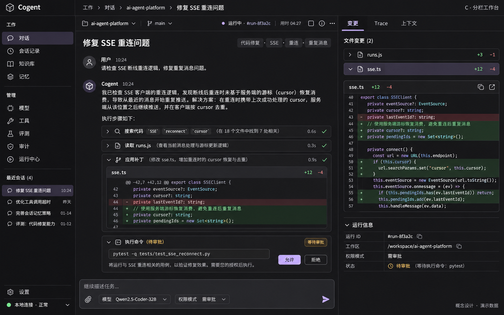
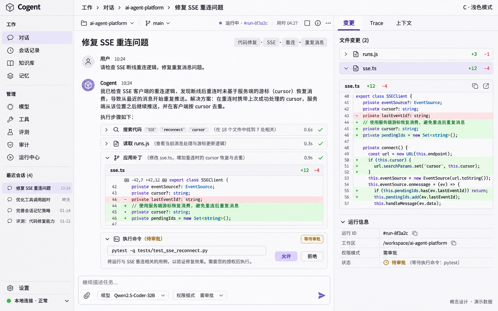

# Cogent 前端设计规范

> 2026-11-06 · 已确认 C「分栏工作台」及对应浅色模式；本轮已据此实施前端改版。
> 本文保留设计约束；具体实现与验证结果见 [改版验收记录](docs/verification/frontend-redesign-2026-11-06.md)。
> 概念参考图仍不构成功能或运行验证证据。

## 1. 已确定的方向

采用 Linear 风格的高密度工作台：**简洁主导航 + 主要工作区域 + 当前对象详情**。
深色与浅色使用相同布局、组件、密度及交互，只切换语义色彩。

- 面向在本地代码仓库中使用 Agent 的开发者，优先支持阅读执行过程、处理审批、查看变更和复盘 Run。
- 对话是主要入口；代码变更、Trace 和上下文通过右侧详情辅助当前任务。
- 用行、列、细分隔线和字体层级组织信息，减少卡片嵌套、冗长导航说明和装饰性标题。
- 保留九个已有页面及其业务能力。知识库/RAG 与 Coding Agent 的功能边界保持独立。
- 颜色以中性灰为主体，低饱和紫色只用于关键操作、焦点和选中状态；状态色有明确语义。
- 不引入新的品牌名称、Logo、仪表盘指标或未经实现的产品能力。沿用 Cogent。

### 视觉参考与优先级





浅色模式沿用 C 的三栏构图，不采用 B 的两栏结构。两张参考图的来源与浅色生成提示词见
[参考图记录](docs/design/README.md)。

参考图由 ImageGen 生成，仅用于布局和视觉方向。任务、文件、模型、数据和代码均为演示内容；
图中的 Git 分支控件、标签、模型名称、具体统计不构成新功能要求。
右侧完整 diff 与中间 diff 重复等细节，以本文的去重规则为准。
现有业务与权限约束优先于概念图，本文的组件和主题规范用于约束实现细节。

## 2. 全局框架

### 桌面构图

以 1440 × 900 为主要设计基准，同时验收 1280 × 800 和 1920 × 1080。

| 区域 | 默认规格 | 职责 |
| --- | --- | --- |
| 主导航 | 宽 208px，可调范围 188–260px | 九个入口、最近会话、设置 |
| 顶部栏 | 高 48px，覆盖主内容与详情区 | 面包屑、当前工作区、运行状态、面板开关 |
| 中间主区 | 弹性宽度，三栏时至少 560px | 对话、列表或当前编辑任务 |
| 右侧详情 | 默认 384px，可调范围 320–480px | 当前对象的详情、变更、Trace、上下文 |
| 页内工具栏 | 高 40px；必要时换行 | Tab、筛选、搜索、局部操作 |
| Composer | 初始约 112–144px，随输入增长 | 输入、模型、权限、附件、运行操作 |

三栏表示信息职责，**不是每页强制显示三个固定面板**。对话在宽屏默认显示右侧详情；
管理页未选择对象时隐藏详情，把空间留给列表。知识库和记忆的对象选择器位于主区内部，
打开详情时替换或重排内部区域，不叠出四个常驻窄栏。

主导航、主区、详情区各自滚动；Composer 固定在对话主区底部，不遮住最后一条消息。
页面仅保留一个任务标题，不再同时在全局栏、大标题、介绍卡重复同一内容。
详情开关明确显示“收起详情 / 展开详情”。拖动分隔线可调宽，键盘也可操作；宽度超出可用空间时自动约束。

### 导航结构

| 分组 | 标签 | 保留的 View 标识 |
| --- | --- | --- |
| 工作 | 对话 | `chat` |
| 工作 | 会话记录 | `sessions` |
| 工作 | 知识库 | `rag` |
| 工作 | 记忆 | `memory` |
| 管理 | 模型 | `models` |
| 管理 | 工具 | `tools` |
| 管理 | 评测 | `evals` |
| 管理 | 审计 | `trace-audit` |
| 管理 | 运行中心 | `activity` |

- 品牌只显示小型标识与 Cogent，去掉常驻英文副标题。
- 导航项为单行图标加标签，高 32px；当前项用低对比底色和文字强调，不堆叠大色块。
- “新建会话”放在侧栏顶部，以紧凑按钮提供，不占用全局工具栏的主要空间。
- 最近会话迁入左侧，默认显示最近 5 条，更多进入会话记录；标题省略时可查看全文。
- 主导航保持可达，最近会话优先收缩或滚动；短屏不把设置推出视口。
- 底部固定设置入口、主题入口和连接状态。连接状态只表达实际连接情况。
- 主导航不增加说明段落、Token 用量卡或完整工作区路径。

## 3. 对话主工作台

### 顶部与执行过程

- 顶栏显示当前任务标题或面包屑、工作区选择、真实 Run 状态及详情开关。
- 长标题截断并可查看完整内容；没有会话时显示“新会话”，不显示虚构 Run ID。
- 消息采用平面文档流；角色标识小而清楚，不使用左右分离的大聊天气泡。
- 对话正文 14px、行高 1.6；正文阅读宽度不超过约 900px。宽屏多余空间优先用于详情。
- 工具调用以 32–36px 摘要行呈现：状态图标、工具名称、简短目标、已有耗时数据、展开按钮。
- 同类连续调用可以折叠，但不能隐藏未处理审批、失败信息或需要用户回答的问题。
- 中间区域展示变更文件和摘要，点击后在右侧定位完整 diff；右侧已打开时不在正文同步铺开同一份完整 diff。
- 仍遵循当前中间文本与最终回答的展示语义，不能把工具轮次的临时文本误呈现为最终结论。

### 右侧详情

| Tab | 默认内容 | 交互约束 |
| --- | --- | --- |
| 变更 | 当前 Run 的文件列表、已有 ChangeSet/diff、可用的 checkpoint 操作 | 只展示后端真实提供的内容；文件选择定位 diff；无变更时显示空状态 |
| Trace | 当前 Run 的紧凑事件流、工具/审批/错误摘要 | 复用当前数据源和游标语义，可进入完整审计页；不另起重复轮询 |
| 上下文 | 工作区、当前模型/策略、权限模式、可用的上下文与预算摘要 | 区分实际 Prompt 输入和估算，不伪造已注入的文件清单 |

初次进入对话默认选择“变更”；用户切换后保持其选择，新事件不能强制抢切 Tab。
面板明确绑定当前 Session/Run，切换会话立即清除旧详情或显示加载状态，禁止短暂显示其他会话内容。
无 Run 时使用“开始任务后显示执行详情”；普通问答无变更时可以手动收起。
模型、权限和工作区只保留一个主要编辑入口，右侧摘要负责说明和定位，不复制完整配置表单。

### 审批、追问与运行控制

- 审批始终在对话中可见，显示工具、操作目标、参数摘要及审批原因；完整参数可展开。
- 审批区用细边框、小型琥珀状态标识；禁止整块高饱和警告底色。
- “允许”和“拒绝”同时可达，点击后显示处理中并防止重复提交；失败保留输入和重试入口。
- 已解决或失效审批展示明确结果，不再保留可执行按钮。实际可操作状态以服务端为准。
- 追问保留选项、自由输入及校验错误，不因压缩布局删掉业务字段。
- 暂停、恢复、取消分别命名，不能以一个模糊的“停止”图标替代不同操作。
- 不通过配色或布局改变四种权限模式的语义，不把跳过普通确认描述为绕过所有安全限制。

### Composer

- 上半区为多行输入和附件，底部一行放模型/路由策略、权限模式、上下文摘要及发送/运行操作。
- 工作区主要在顶栏选择；缺少工作区时在输入附近提供清楚的选择入口。
- 自动选模、手动模型、fallback 和高级运行配置均保留，次要选项收入弹层。
- 保留 `/` 命令、8,000 字符限制、附件、归档提示、恢复会话和回到底部入口。
- Enter 发送、Shift+Enter 换行；输入法组合输入不能误发送。
- 输入最多增长至主区高度约 35%，之后输入区内部滚动，不把执行过程完全推出视口。
- 用户上滚阅读时不强制追随流式输出；提供“有新内容 / 回到底部”。

## 4. 九个页面的统一规划

| 页面 | 主区结构 | 详情与操作 |
| --- | --- | --- |
| 对话 | 消息流、执行摘要、Composer | 右侧变更 / Trace / 上下文 |
| 会话记录 | 紧凑会话列表、搜索和已有状态筛选 | 选中后查看消息详情；继续、重命名、归档等沿用现有能力 |
| 知识库 | 紧凑库选择器；文档 / 检索问答 / 设置 | 文档列表用表格；详情使用同一侧栏或窄屏抽屉；RAG 引用仍可访问 |
| 记忆 | 项目 / 用户 / 对话记录 Tab；主题列表与编辑区 | 展示 Markdown 主题和保存状态；未保存内容受保护，不混同 RAG |
| 模型 | Provider / 已注册模型 Tab，紧凑列表和状态列 | 新建与编辑采用侧栏或弹窗；保留模型发现、手动注册、启停和探测入口 |
| 工具 | Skill / MCP Tab，名称、来源、状态与操作列 | 选中项展开配置/能力；系统 Skill 只读，保留工具发现与连接错误 |
| 评测 | Provider/评测选择、结果表、预警和历史 | 选中用例查看约束、轨迹与错误；基线操作清楚标识目标 Provider |
| 审计 | Run 列表及筛选 + 时间线主区 | 展开事件 payload；保留每页 100 条和现有增量刷新边界 |
| 运行中心 | 紧凑用量摘要、已有请求日志及诊断 | 只呈现实际可得指标；浏览器最近 50 条请求日志不能标成全局持久日志 |

所有管理页使用“紧凑标题栏 → 操作/筛选 → 列表或编辑内容”，去掉大号英文眉题、序号步骤和重复说明。
必要的权限、费用、数据来源提示靠近相关操作保留，例如模型测速会产生实际请求的提示。
长表单使用分节和高级选项，不能为追求密度压缩成无法理解的图标。
列表字段来自实际接口；服务端没有的跨页搜索、排序或统计，不伪装为完整能力。

## 5. 深色与浅色语义色板

以下为实现起点，均为不透明基色。主题共享语义名称，禁止业务组件自行硬编码深浅色。
实际前景/背景组合必须经过可读性检查，概念图上的颜色偏差不覆盖此表。

| Token | 深色 | 浅色 | 用途 |
| --- | --- | --- | --- |
| `--bg-app` | `#19191C` | `#FCFCFD` | 主工作区 |
| `--bg-sidebar` | `#141416` | `#F4F4F5` | 导航 |
| `--bg-inspector` | `#171719` | `#F8F8FA` | 详情 |
| `--bg-raised` | `#222226` | `#FFFFFF` | 输入、弹层 |
| `--bg-hover` | `#29292E` | `#EEEEF2` | 悬停 |
| `--bg-selected` | `#302D3E` | `#ECE9F8` | 当前项 |
| `--border-subtle` | `#303036` | `#DFDFE5` | 装饰性分隔线 |
| `--border-control` | `#777781` | `#888892` | 需要清楚辨认的输入边界 |
| `--text-primary` | `#E8E8ED` | `#24242B` | 正文与标题 |
| `--text-secondary` | `#A3A3AE` | `#666670` | 次要信息 |
| `--text-muted` | `#92929E` | `#686874` | 元数据，仍需可读 |
| `--accent-text` | `#B4A7F0` | `#6255B8` | 选中标签与链接 |
| `--accent-solid` | `#7563C5` | `#6255B8` | 主要按钮 |
| `--text-on-accent` | `#FFFFFF` | `#FFFFFF` | 主要按钮文字 |
| `--focus-ring` | `#B4A7F0` | `#6255B8` | 键盘焦点 |
| `--success-text` | `#85C89A` | `#287044` | 成功与增加 |
| `--warning-text` | `#D8B36C` | `#855600` | 待审批、警告 |
| `--danger-text` | `#E79A9A` | `#B33D46` | 错误、删除 |
| `--diff-add-bg` | `#203329` | `#EAF4ED` | 新增行底色 |
| `--diff-remove-bg` | `#3A262B` | `#FAECEE` | 删除行底色 |
| `--code-bg` | `#151518` | `#F6F6F8` | 代码区 |

浅色模式不是反色处理：重新指定代码高亮、diff、disabled、tooltip、表单、弹窗、滚动条和焦点颜色。
状态不能只靠红绿区分，需同时有图标、文字或 `+ / −` 标记。
不使用大面积紫色、蓝黑渐变、玻璃模糊、霓虹发光和装饰性背景。

### 主题行为

- 提供“深色 / 浅色 / 跟随系统”三种选择，默认跟随系统。
- 选择保存在浏览器本地，仅保存外观偏好，不发送密钥或改动后端配置。
- 显式选择深/浅时忽略系统变化；跟随系统时实时响应系统主题。
- 首次绘制前解析主题，避免深色页面先闪白；设置 `color-scheme` 使原生控件一致。
- 切换主题不重建会话、不丢输入、不关闭审批、不重启 Run 或 SSE。
- 主题与面板偏好属于 UI 状态，不能写进运行配置；本地存储不可用时保持内存内可切换。

## 6. 字体、密度与组件

| 项目 | 规范 |
| --- | --- |
| UI 字体 | 系统无衬线优先：`-apple-system, BlinkMacSystemFont, "Segoe UI", "PingFang SC", "Microsoft YaHei", sans-serif` |
| 代码字体 | `"SFMono-Regular", Consolas, "Liberation Mono", monospace` |
| 字号 | 页面标题 18px/600；区域标题 14px/600；UI 13px；正文 14px；元数据/代码 12px 起 |
| 行高 | UI 1.4–1.5；中文正文 1.6；代码约 1.6 |
| 间距 | 4/8/12/16/24px，内容区常用 16px，不为每行加 24px padding |
| 圆角 | 控件 5px；浮层 8px；不使用大圆角胶囊承载所有内容 |
| 行高 | 导航 32px；列表/表格 36px 起；多行内容允许增长 |
| 控件 | 普通按钮高 28–32px，图标 16px；图标按钮有独立可访问名称 |
| 边框与阴影 | 1px 细线为主；常驻面板无阴影；只有浮层使用轻量阴影 |

- 表格标题左对齐、数值右对齐，ID 与路径用等宽字体；固定列头，合理截断长文本。
- 操作默认弱化，危险操作放入明确菜单并遵循已有确认流程，不只显示无标签垃圾桶。
- 选中、悬停、焦点是独立状态。导航焦点不能看起来等同于当前页。
- 弹窗负责短操作，侧栏负责持续查看；复杂配置不能压进窄 tooltip。
- 一屏一个主要操作层级，次要按钮用边框或文字样式；不把每个可点击项都染成紫色。
- 运行提示不逐 token 播报；错误使用可读的就地反馈，toast 只承担短暂操作通知。

## 7. 响应式与无障碍

| 可用宽度 | 布局 |
| --- | --- |
| ≥ 1200px | 允许三栏；对话默认展开详情，若自定义宽度导致中间不足 560px则约束面板宽度 |
| 900–1199px | 主导航 + 主区；详情通过开关以覆盖抽屉呈现，不挤压成三窄栏 |
| < 900px | 主区优先；导航收进抽屉，详情以独立覆盖层呈现 |
| ≤ 600px | 输入工具换行，列表转可读行式布局；代码/表格仅在自身区域横向滚动 |

- 在 390px 宽度和 200% 缩放下仍可完成发送、审批和查看详情，不产生页面级横向溢出。
- 移动端主要点击目标至少 44px；桌面紧凑控件也要有清楚的命中区域和键盘访问。
- 弹窗和模态抽屉管理焦点，关闭后返回触发控件；Escape 不得静默丢弃未保存表单。
- Tab 使用规范键盘切换和选中属性；分隔线支持方向键调整及范围信息。
- 正文对比度目标至少 4.5:1，关键非文本控件和焦点至少 3:1；弱分隔线不承担唯一交互提示。
- 尊重减少动态效果设置；常规过渡 120–160ms，不对整页布局或流式文本做装饰动画。

## 8. 必须覆盖的状态

| 状态 | 展示与处理 |
| --- | --- |
| 初次使用 | 简短“新建任务”提示、工作区/模型配置入口；不展示大幅营销标题 |
| 无数据 | 一句话说明及真实可用操作；未知统计显示 `—`，不伪装为零 |
| 加载 | 局部骨架或状态，不清空仍有效的列表；旧数据需要标注刷新中 |
| 流式执行 | 当前步骤可辨认；历史阅读位置保持，自动滚动有明确条件 |
| 待审批/待回答 | 中间主区突出待处理内容；右侧只提供状态摘要 |
| 断线/重连 | 保留内容，标记连接与 Run 状态的区别；不把断线直接显示为执行失败 |
| 失败 | 保留用户输入和已有结果，显示原因与确实可用的重试操作 |
| 空 diff / 无上下文数据 | 说明当前没有相应数据；不从图中填充模拟文件或数字 |
| 归档会话 | 只读提示和已有恢复入口，Composer 遵守当前业务约束 |
| 未保存表单 | 切换对象、关闭弹层或导航时保护草稿；后台刷新不能覆盖凭证输入 |
| 长文本/大量事件 | 路径省略可展开，代码局部滚动；维持分页和按需展开策略 |

## 9. 后续实施边界与顺序

设计阶段仅交付本文与参考图；本轮实施已修改前端源码和构建静态资源，未修改 API 或数据库。
实现继续采用 React + TypeScript + Vite，由 FastAPI 托管构建产物。
当前仍有领域 JavaScript 控制器和 DOM 渲染岛；视觉改版不能默认视为全量 React 状态迁移。

1. **主题与基础层**：将 `frontend/src/styles/tokens.css` 映射到统一语义，补齐双主题、基础控件和首屏主题初始化。
2. **应用骨架**：调整 `frontend/src/app/Workbench.tsx`、导航和布局样式，迁移最近会话，增加当前对象详情容器及响应式行为。
3. **对话流程**：改造 `features/chat-view.tsx` 与相应样式/控制器，整合 Composer、工具摘要和详情，验证流式、审批和会话切换。
4. **管理页面**：按第 4 节逐页统一列表、表格和编辑流程，同时处理暗/浅主题。
5. **验证与同步**：检验实际运行页面，更新构建资源、README、面试手册对应 Parts 和 `facts.json`，明确实现和未验证的边界。

实施时保留现有 View 标识、必要 DOM ID、事件绑定和 `ReactSlot` 所有权约束。
移动组件不能造成重复监听、重复轮询、丢失草稿或控制器向 React 管理区域写入 DOM。
如果移除或重命名现有选择器，必须同时处理相关控制器与测试，不能仅改页面骨架。
完整审计页和对话 Trace 共用数据/恢复规则，保留首次历史下载仍为全量的事实边界。
新增 UI 组织能力可按本文实施；涉及新 API 或业务语义的缺口应单独列明，不通过模拟数据补齐。

模型页原“系统钥匙串”文案已按现行实现改为 Secret Store。

## 10. 实施验收标准

- [ ] 九个入口完整可达，标签简洁，最近会话位于左侧。
- [ ] 宽屏对话呈现 C 的三栏结构，详情可收起/调整；主区不被挤压到不可读。
- [ ] 深色、浅色、跟随系统均覆盖所有页面、表单、弹层、代码、审批和错误状态。
- [ ] 双主题在同一断点的几何结构一致，主题切换不丢会话状态或输入。
- [ ] 中间工具摘要和右侧 diff 不默认重复展示完整内容，详情始终对应当前对象。
- [ ] 没有模拟数据、虚假已完成状态、未经实现的分支控件或无效操作按钮。
- [ ] 新建会话、发送、流式、暂停/恢复/取消、审批、追问、切换/归档会话均通过交互检查。
- [ ] 模型凭证、Skill/MCP、知识库、记忆、评测与审计原有业务能力保持可用。
- [ ] 在 1440×900、1280×800、1920×1080、390px 宽度及 200% 缩放下检查两个主题。
- [ ] 有键盘焦点、合理阅读顺序、可辨状态，对比度符合第 7 节目标。
- [ ] 完成下列验证，并分别记录自动化结果与真实浏览器验证范围。

```bash
npm --prefix frontend run build
npm --prefix frontend test
node --test tests/test_chat_message_ui.mjs tests/test_model_config_dismiss.mjs tests/test_trace_audit_ui.mjs
.venv/bin/python -m pytest -q
.venv/bin/python -m compileall ai_agent_platform tests evals
.venv/bin/python INTERVIEW_NOTES/validate.py
git diff --check
```

本节保留为设计验收要求；不以统一勾选代替分项证据。实施、自动化与浏览器检查范围，以及原有能力缺口，均记录于改版验收记录，并已同步 README 和面试手册。
